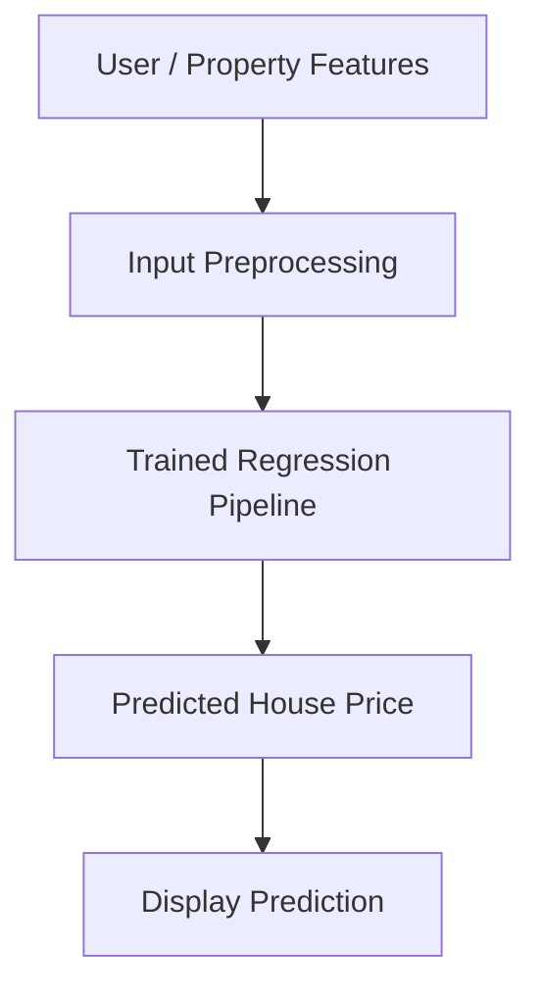
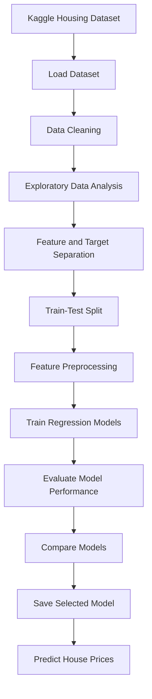

# 🏠 House Price Prediction

<p align="center">
  <b>A Machine Learning Regression Application for Predicting House Prices</b>
</p>

<p align="center">
  
  
  
  
</p>

---

## 🚀 Project Overview

The **House Price Prediction** project uses machine learning regression algorithms to estimate house prices based on property features such as area, bedrooms, bathrooms, parking, and furnishing status.

The project uses the Housing Prices dataset from Kaggle and compares multiple regression algorithms to identify a model that predicts prices effectively.

The objective is to understand the complete machine learning workflow, including data preprocessing, exploratory data analysis, model training, evaluation, and price prediction.

## 🌐 Live Demo

🚀 **Try the application:** Add your deployed application URL here.

💻 **Source Code:** Add your GitHub repository URL here.

*The live demo will be available after deploying the project.*

## ✨ Features

- 🏠 Predict house prices using property characteristics.
- 📊 Explore housing data through exploratory data analysis.
- 🧹 Handle missing values and preprocess categorical features.
- 🔢 Convert categorical variables into numerical features using One-Hot Encoding.
- 🤖 Train and compare multiple regression algorithms.
- 📈 Evaluate predictions using MAE, RMSE, and R² score.
- 💾 Save the trained machine learning pipeline.
- 🔮 Predict prices for new property inputs.

## 🏗️ System Architecture



## 🔄 Machine Learning Workflow



## 🧠 Model Details

| Component | Description |
|---|---|
| Problem Type | Supervised regression |
| Input | Housing and property features |
| Target Variable | `price` |
| Linear Model | Linear Regression |
| Tree-Based Model | Decision Tree Regressor |
| Ensemble Model | Random Forest Regressor |
| Feature Encoding | One-Hot Encoding |
| Missing Value Handling | SimpleImputer |
| Machine Learning Library | Scikit-learn |
| Evaluation Metrics | MAE, RMSE, R² |
| Model Serialization | Joblib |

### Models Used

**1. Linear Regression**

Provides a baseline model by learning a linear relationship between property features and house prices.

**2. Decision Tree Regressor**

Learns decision rules from the dataset and can capture nonlinear relationships between property features and prices.

**3. Random Forest Regressor**

Combines multiple decision trees to improve prediction stability and capture more complex patterns.

The models are evaluated on the same test dataset. The final model should be selected based on actual evaluation results rather than assuming that one algorithm will always perform best.

## 📊 Dataset

This project uses the **Housing Prices Dataset** from Kaggle.

🔗 **Dataset Link:** [Housing Prices Dataset — Kaggle](https://www.kaggle.com/datasets/yasserh/housing-prices-dataset/data)

The dataset contains housing records with features describing property size, rooms, amenities, and furnishing status.

### Dataset Preparation

- Loaded the CSV dataset using Pandas.
- Inspected column names, data types, and statistical summaries.
- Checked missing values and duplicate records.
- Explored the distribution of house prices.
- Separated input features from the target variable.
- Split the data into training and testing sets.
- Prepared numerical and categorical features for model training.

**Target variable:** `price`

**Note:** The model estimates prices based on patterns in this dataset. Its predictions should not be treated as guaranteed market valuations.

## 💡 Example Prediction

A user provides property details such as:

- Area
- Number of bedrooms
- Number of bathrooms
- Number of floors
- Main-road access
- Guestroom availability
- Basement and air-conditioning availability
- Parking capacity
- Furnishing status

The trained model processes these features and returns an estimated house price.

*The predicted amount depends on the trained model and the property inputs. No example price is claimed as an actual model result.*

## 🛠️ Tech Stack

- **Language:** Python
- **Data Processing:** Pandas, NumPy
- **Data Visualization:** Matplotlib, Seaborn
- **Machine Learning:** Scikit-learn
- **Regression Algorithms:** Linear Regression, Decision Tree, Random Forest
- **Feature Engineering:** One-Hot Encoding
- **Missing Value Handling:** SimpleImputer
- **Model Serialization:** Joblib
- **Development Environment:** Google Colab

## 📁 Project Structure

```text
house-price-prediction/
│
├── Housing.csv
├── house_price_model.pkl
├── requirements.txt
├── README.md
│
└── src/
    ├── train.py
    ├── evaluate.py
    └── predict.py
```

*This is the intended structure for organizing the project. Include only files that you have actually created.*

## ⚙️ Installation and Usage

### 1. Clone the repository

```bash
git clone YOUR_GITHUB_REPOSITORY_URL
cd house-price-prediction
```

Replace `YOUR_GITHUB_REPOSITORY_URL` with your actual repository URL.

### 2. Install dependencies

```bash
python -m pip install pandas numpy matplotlib seaborn scikit-learn joblib
```

### 3. Run the notebook

Open the notebook in Google Colab, upload `Housing.csv`, and execute the cells in order to preprocess the dataset, train the models, and compare their performance.

## 🔁 Train the Models

The training workflow includes:

1. Loading and cleaning the dataset.
2. Separating the features and target.
3. Creating training and testing sets.
4. Preprocessing numerical and categorical columns.
5. Training Linear Regression, Decision Tree, and Random Forest.
6. Comparing model evaluation metrics.

The selected model can then be saved for reuse.

## 📈 Model Evaluation

The models are compared using the following metrics:

| Metric | Purpose | Preferred Result |
|---|---|---|
| MAE | Average absolute prediction error | Lower |
| RMSE | Penalizes larger prediction errors | Lower |
| R² Score | Measures explained variation in prices | Generally higher |

The best model will be determined from the actual evaluation results obtained during training.

## 🎯 Project Objective

The objective is to demonstrate how supervised machine learning can be applied to a regression problem, using housing data to learn relationships between property characteristics and prices.

The project provides practical experience in data analysis, feature engineering, regression algorithms, model evaluation, and deployment preparation.

## 🔮 Future Improvements

- Build an interactive Streamlit prediction interface.
- Tune model hyperparameters using cross-validation.
- Add feature importance analysis.
- Test the model on additional housing datasets.
- Deploy the application online.
- Improve generalization to properties outside the training dataset.

## 👨‍💻 Author

**Tanush Kumar**

B.Tech CSE — Artificial Intelligence & Machine Learning  
Expected Graduation: 2028

- GitHub: [tanush090](https://github.com/tanush090)
- LinkedIn: [tanush0900](https://www.linkedin.com/in/tanush0900/)
- Portfolio: [tanush-portfolio-26.vercel.app](https://tanush-portfolio-26.vercel.app)

---

<p align="center">
  ⭐ If you find this project interesting, consider starring the repository!
</p>
